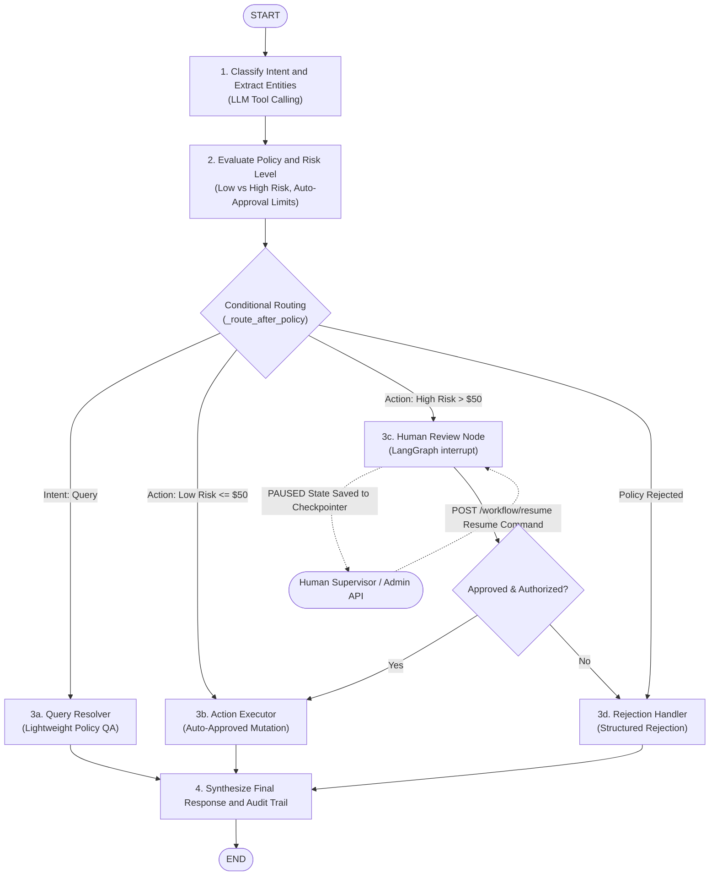
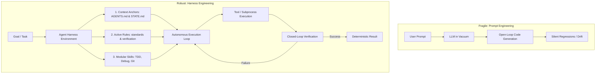

# AI Engineering & Service Platform Knowledge Base

## Table of Contents

- [Day 1 - LLM Integration Fundamentals](#day-1--llm-integration-fundamentals)
  - [1. Streaming (How it works under the hood)](#1-streaming-how-it-works-under-the-hood)
  - [2. Structured Output (How it guarantees the schema)](#2-structured-output-how-it-guarantees-the-schema)
  - [3. Function Calling (The execution loop)](#3-function-calling-the-execution-loop)
  - [4. Cost & Token Tracking](#4-cost--token-tracking)
  - [5. Resiliency (Gotchas & Production Setup)](#5-resiliency-gotchas--production-setup)
- [Day 2 - FastAPI Service Setup & Clean Architecture](#day-2--fastapi-service-setup--clean-architecture)
  - [1. Layered clean architecture roles](#1-layered-clean-architecture-roles)
  - [2. Async exceptions and global mapping](#2-async-exceptions-and-global-mapping)
  - [3. Async generator gotcha](#3-async-generator-gotcha)
  - [4. Tenacity integration for async retries](#4-tenacity-integration-for-async-retries)
- [Day 3 - RAG Basics: Chunking, Embeddings, pgvector, and Document Q&A](#day-3--rag-basics-chunking-embeddings-pgvector-and-document-qa)
  - [1. Chunking Strategies: Fixed-Size vs. Semantic](#1-chunking-strategies-fixed-size-vs-semantic)
  - [2. pgvector & asyncpg Setup](#2-pgvector--asyncpg-setup)
  - [3. RAG Pipeline Orchestration](#3-rag-pipeline-orchestration)
- [Day 4 - Production RAG: Hybrid Retrieval, Reranking, Query Expansion](#day-4--production-rag-hybrid-retrieval-reranking-query-expansion)
  - [1. Embeddings / Dense Retrieval](#1-embeddings--dense-retrieval)
  - [2. BM25 / Sparse Retrieval](#2-bm25--sparse-retrieval)
  - [3. Hybrid Retrieval](#3-hybrid-retrieval)
  - [4. Query Expansion](#4-query-expansion)
  - [5. RRF - Reciprocal Rank Fusion](#5-rrf--reciprocal-rank-fusion)
  - [6. Cross-Encoder Reranking](#6-cross-encoder-reranking-the-careful-final-judge)
- [Day 5 - Framework-First RAG with LlamaIndex: Under-The-Hood Analysis](#day-5--framework-first-rag-with-llamaindex-under-the-hood-analysis)
  - [1. Step-by-Step LlamaIndex Pipeline Mechanics](#1-step-by-step-llamaindex-pipeline-mechanics)
  - [2. Multi-Threading Pattern in Async Framework Adapters (`ThreadPoolExecutor`)](#2-multi-threading-pattern-in-async-framework-adapters-threadpoolexecutor)
  - [3. Sync vs. Async vs. Threading Mental Model (Universal Backend Rules)](#3-sync-vs-async-vs-threading-mental-model-universal-backend-rules)
- [Day 8 - Autonomous Agents with LangGraph: State Machine Mindset](#day-8--autonomous-agents-with-langgraph-state-machine-mindset)
  - [1. Pipelines vs. Autonomous Agents](#1-pipelines-vs-autonomous-agents)
  - [2. State Machines & Graph Architecture](#2-state-machines--graph-architecture)
  - [3. The ReAct Pattern (Reason + Act + Observe)](#3-the-react-pattern-reason--act--observe)
  - [4. Tool Calling & Observation Accumulation](#4-tool-calling--observation-accumulation)
  - [5. Production Guardrails & Safety Patterns](#5-production-guardrails--safety-patterns)
- [Day 9 - LangGraph Multi-Step Flows, Conditional Routing & Human-in-the-Loop (HITL)](#day-9--langgraph-multi-step-flows-conditional-routing--human-in-the-loop-hitl)
  - [1. Core Philosophy & The "AI as an Intern" Mental Model](#1-core-philosophy--the-ai-as-an-intern-mental-model)
  - [2. Declarative State Machines vs. Runtime Orchestration](#2-declarative-state-machines-vs-runtime-orchestration)
  - [3. Multi-Step Workflow Graph Architecture](#3-multi-step-workflow-graph-architecture)
  - [4. Conditional Routing Mechanics](#4-conditional-routing-mechanics)
  - [5. Human-in-the-Loop (HITL) & State Persistence Design](#5-human-in-the-loop-hitl--state-persistence-design)
  - [6. Production Guardrails, Safety Patterns & Idempotency](#6-production-guardrails-safety-patterns--idempotency)
  - [7. Real-World Execution Scenarios Reference](#7-real-world-execution-scenarios-reference)
- [Day 11 — Model Context Protocol (MCP) Fundamentals & Architecture](#day-11--model-context-protocol-mcp-fundamentals--architecture)
  - [1. Core Motivation: The M×N Integration Bottleneck](#1-core-motivation-the-mn-integration-bottleneck)
  - [2. MCP Primitives: Tools, Resources, and Prompts](#2-mcp-primitives-tools-resources-and-prompts)
  - [3. Protocol Specification & Lifecycle](#3-protocol-specification--lifecycle)
  - [4. Client-Server Negotiation Mechanics](#4-client-server-negotiation-mechanics)
  - [5. Transport Layers: STDIO vs. SSE/HTTP](#5-transport-layers-stdio-vs-ssehttp)
  - [6. Security Model & Execution Boundaries](#6-security-model--execution-boundaries)
- [Day 12 — Building MCP Servers with FastMCP (Database Tool Integration)](#day-12--building-mcp-servers-with-fastmcp-database-tool-integration)
  - [1. FastMCP vs. Low-Level MCP SDK](#1-fastmcp-vs-low-level-mcp-sdk)
  - [2. Docstrings as Primary Prompt Engineering Surface](#2-docstrings-as-primary-prompt-engineering-surface)
  - [3. Structural Evolution: In-Process Tools vs. Standalone MCP Server](#3-structural-evolution-in-process-tools-vs-standalone-mcp-server)
  - [4. Production Hardening for DB-Backed MCP Servers](#4-production-hardening-for-db-backed-mcp-servers)
  - [5. Resilient Error Handling & The ReAct Self-Correction Loop](#5-resilient-error-handling--the-react-self-correction-loop)
  - [6. Architectural Tradeoffs: In-Process vs. MCP vs. REST+OpenAPI](#6-architectural-tradeoffs-in-process-vs-mcp-vs-restopenapi)
- [Day 13 — Connecting LangGraph Agent to MCP Server (Multi-Turn Real Data)](#day-13--connecting-langgraph-agent-to-mcp-server-multi-turn-real-data)
  - [1. The Paradigm Shift: In-Process vs. Protocol-Driven Dynamic Tools](#1-the-paradigm-shift-in-process-vs-protocol-driven-dynamic-tools)
  - [2. Mechanics of `langchain-mcp-adapters` & `MultiServerMCPClient`](#2-mechanics-of-langchain-mcp-adapters--multiservermcpclient)
  - [3. Subprocess Isolation & STDIO Transport Invariants](#3-subprocess-isolation--stdio-transport-invariants)
  - [4. Multi-Turn Continuity & Coreference Resolution over Real Data](#4-multi-turn-continuity--coreference-resolution-over-real-data)
  - [5. Resilient Self-Correction in ReAct Loops](#5-resilient-self-correction-in-react-loops)
  - [6. Provider Quota & Rate Limit Resiliency (Production Gotcha)](#6-provider-quota--rate-limit-resiliency-production-gotcha)
- [Day 13.1 — Agent Harness Engineering & Autonomous Operating Systems](#day-131--agent-harness-engineering--autonomous-operating-systems)
  - [1. The Paradigm Shift: Prompt Engineering vs. Harness Engineering](#1-the-paradigm-shift-prompt-engineering-vs-harness-engineering)
  - [2. The 3 Core Pillars of a Production Agent Harness](#2-the-3-core-pillars-of-a-production-agent-harness)
  - [3. Closed-Loop Verification vs. Open-Loop Generation](#3-closed-loop-verification-vs-open-loop-generation)
  - [4. Modular On-Demand Skills & Token Economics](#4-modular-on-demand-skills--token-economics)
  - [5. Architectural Tradeoffs: Prompting vs. Static Prompts vs. Harness](#5-architectural-tradeoffs-prompting-vs-static-prompts-vs-harness)
  - [6. Production Invariants & Engineering Takeaways](#6-production-invariants--engineering-takeaways)
- [Day 14 — Agent vs. RAG (When to Use Which), When NOT to Use Agents](#day-14--agent-vs-rag-when-to-use-which-when-not-to-use-agents)
  - [1. Agent vs. RAG (When to Use Which)](#1-agent-vs-rag-when-to-use-which)
  - [2. When NOT to Use Agents (Production Invariants)](#2-when-not-to-use-agents-production-invariants)

---

# Day 1 - LLM Integration Fundamentals

### 1. Streaming (How it works under the hood)
*   **Concept:** Uses **Server-Sent Events (SSE)** over a standard HTTP connection (using `Transfer-Encoding: chunked`), not WebSockets.
*   **Behavior:** The server keeps the TCP socket open and pushes data chunk-by-chunk (using standard formatted lines starting with `data: `) as the model generates tokens in real-time.

### 2. Structured Output (How it guarantees the schema)
*   **Concept:** Uses **constrained decoding** at the provider gateway. The model is mathematically blocked from choosing tokens that would violate the defined JSON schema.
*   **Pydantic Role:** The API enforces the structure, while local Pydantic validation (`model_validate_json`) converts the raw JSON string into a type-safe Python object for IDE auto-complete and fail-safe recovery (e.g. if the connection is cut off).

### 3. Function Calling (The execution loop)
*   **Concept:** An agent loop where the client provides function schemas, the model returns a structured request to call a function (`tool_calls`), the client executes it locally, and the client sends the result back to the model.
*   **Why Registry:** A dictionary dispatch registry (`TOOL_MAP`) is preferred over nested `if-else` blocks to decouple registration from execution logic.

### 4. Cost & Token Tracking
*   **Pre-flight:** Count tokens locally/offline using a tokenizer (e.g., `tiktoken` matching the model's vocabulary) to avoid context limit overflow.
*   **Post-call:** Extract exact token counts from the response metadata (`response.usage`). Cost is calculated **locally** by multiplying these counts against the model's pricing rates.

### 5. Resiliency (Gotchas & Production Setup)
*   **Transient Failures:** APIs throw transient errors (`503 Service Unavailable`, `429 Rate Limit`). Always use native SDK parameters like `num_retries` or library-level decorators (like `tenacity`) for automatic backoff.
*   **Model Routing:** Swapping models via LiteLLM is easy, but watch prefixes (e.g., use `gemini/` prefix to force routing through AI Studio instead of Vertex AI).

# Day 2 - FastAPI Service Setup & Clean Architecture

TDLR: It's basically the Day 1 features hosted as a Fast API server (Ai Platform).

### 1. Layered clean architecture roles
*   **Client Layer (`client.py`):** Acts as the boundary driver for upstream API integrations. Wraps LiteLLM `acompletion`, encapsulates retries, and translates vendor exceptions into custom domain exceptions to keep downstream business logic vendor-agnostic.
*   **Service Layer (`service.py`):** Holds pure business domain orchestration (e.g. structured data mapping/validation, token consumption, dynamic costing). Is completely decoupled from HTTP concerns.
*   **Route/Controller Layer (`routes.py`):** Handlers that receive inputs, run Pydantic validations, pass requests to the Service, and form HTTP responses. Decoupled from LLM client library details.

### 2. Async exceptions and global mapping
*   **Centralized error handling:** Avoid repeating try-except blocks inside FastAPI endpoint routes. Instead, register global FastAPI exception handlers (`app.exception_handler`) to automatically capture custom domain-level exceptions and map them to standard HTTP status codes (`401` for AuthError, `429` for RateLimitError, `503` for ConnectionError, etc.).

### 3. Async generator gotcha
*   **Concept:** Async functions containing `yield` statements return an **async generator object** immediately upon invocation rather than returning a coroutine.
*   **Gotcha:** Trying to do `await client.acompletion_stream(...)` raises `TypeError: 'async_generator' object can't be awaited`. Instead, call it synchronously to get the generator, then consume it with `async for`.

### 4. Tenacity integration for async retries
*   **Rule:** Use tenacity's `AsyncRetrying` wrapper dynamically inside client code, filtering retries exclusively to transient network/rate limit issues, while letting fatal configuration errors (like Auth failures) fail fast.

# Day 3 - RAG Basics: Chunking, Embeddings, pgvector, and Document Q&A

### 1. Chunking Strategies: Fixed-Size vs. Semantic
*   **Fixed-Size Chunking:** Splits text by character count with overlap.
    *   *Design:* Implemented word-boundary backtracking (reversing up to 20% of chunk size to find a space) to prevent clipping words.
    *   *Tradeoff:* Fast, deterministic, and requires no API calls. However, it completely ignores semantic boundaries, which can separate context across chunks.
*   **Semantic Chunking:** Groups sentences based on topic coherence.
    *   *Design:* Breaks document into sentences, generates embeddings, calculates the cosine distance ($1 - \text{cosine\_similarity}$) between adjacent sentences, and triggers a new chunk at distance spikes (threshold ~`0.25`).
    *   *Tradeoff:* Preserves complete thoughts and semantic unity. However, it is slower and incurs higher cost due to embedding calls for every single sentence.
    *   *Optimizations:* All sentence embeddings are fetched in a single batched API call to minimize network roundtrips.

### 2. pgvector & asyncpg Setup
*   **Concept:** Extends PostgreSQL to store and query vector embeddings directly.
*   **Driver Integration:** Registered pgvector with the `asyncpg` connection pool (`register_vector`) to automatically handle encoding/decoding of native Python float lists to Postgres `vector` types.
*   **Index Selection:** Created an **HNSW (Hierarchical Navigable Small World)** index using `vector_cosine_ops` to enable fast approximate nearest neighbors (ANN) search matching the `<=>` cosine distance operator.
*   **Gotcha:** Dynamic schema creation (e.g. vector dimension) cannot be parameterized dynamically via SQL placeholder arguments. The column type `vector({dimension})` must be formatted securely or resolved statically beforehand.

### 3. RAG Pipeline Orchestration
*   **Flow:** Retrieve context first, then synthesize. The query is embedded, the closest matching text chunks are pulled from pgvector, and a system prompt constructs the grounding context for the LLM.
*   **Hallucination Control:** Prompt instruction strictly forces the LLM to state "I do not know" if the answer is not present in the retrieved context.
*   **Cost Efficiency:** Both chunks and queries are embedded asynchronously, using batching where possible. Cost is tracked using `litellm.completion_cost` to maintain budget awareness.

# Day 4 - Production RAG: Hybrid Retrieval, Reranking, Query Expansion

Everything below is 6 concepts + how they're wired together.

## 1. Embeddings / Dense Retrieval
Convert text → vector. Similar meaning → vectors close together (cosine sim / ANN lookup).
- **Good:** understands meaning, catches paraphrases ("laptop broken" → "hardware failure")
- **Bad:** exact identifiers - `PROD-101`, `ERR_4001` - get lost in the embedding space

## 2. BM25 / Sparse Retrieval
Classic TF-IDF keyword search - does the document literally contain the query terms.
- **Good:** exact IDs, error codes, code tokens, rare exact words. Cheap - no model inference.
- **Bad:** no notion of meaning - synonyms/paraphrases miss entirely.

## 3. Hybrid Retrieval
Run dense + BM25 in parallel, combine results. Dense catches meaning, BM25 catches exact keywords - together they cover both failure modes.

**Core Architectural Principle:** always filter deterministically (cheap algorithms/APIs) before spending LLM tokens/reasoning on the data. Same logic applies outside RAG too - e.g. filter raw HTML/job listings with scripts before ever handing them to an LLM.

## 4. Query Expansion
LLM generates N paraphrases/sub-queries of the user's question before retrieval runs (e.g. "reset password" → "forgot password", "change password", "recover account"). Search with all of them.
- **Purpose:** recall - don't miss a good document just because it used different wording.
- **Cost:** N× retrieval calls + N× embedding calls.

## 5. RRF - Reciprocal Rank Fusion
You now have two ranked lists (dense's ranking, BM25's ranking) with scores that aren't comparable to each other. RRF merges them by **rank**, not raw score.

```
RRF_score(d) = Σ 1 / (k + rank_m(d))   over each retrieval method m
```
- k=60 is a smoothing constant - stops rank-1 from dominating everything.
- A document ranked well by *both* methods gets a higher combined score than one only one method liked.
- One-liner: **merge first** - rewards documents multiple retrieval methods agree on.

## 6. Cross-Encoder Reranking (The Careful Final Judge)
Why two stages?
- **Bi-Encoder (Embeddings / Dense Search - Stage 1):**
  - Query and Document are embedded **independently** into separate vectors (`Vec(Q)` and `Vec(D)`).
  - Similarity is calculated via Cosine Distance.
  - *Why Stage 1:* $O(1)$ lightning fast ANN vector index search across 10,000+ docs, BUT query words and document words **never look at each other directly** (no cross-token self-attention).
- **Cross-Encoder (`ms-marco-MiniLM-L-6-v2` - Stage 2):**
  - Feeds `[Query] + [Document Chunk]` **together** into a single Transformer model.
  - Every word in the query directly attends to every word in the document (full cross-token self-attention).
  - Outputs a high-precision relevance score (e.g., `+6.84` for high relevance vs `-11.32` for irrelevant).
  - *Why Stage 2:* Too computationally heavy to run forward passes on 10,000 docs ($O(N)$ inference cost), but ideal for carefully scoring a small **shortlist of 10--20 candidate chunks**.

**Two-Stage Architecture Funnel:**
```text
Corpus (10,000 docs) 
        ↓  [Stage 1: Fast Hybrid Search (Dense + BM25)]
Candidates (~15-20 shortlist)
        ↓  [Stage 2: Cross-Encoder Reranking (Full Cross-Token Attention)]
Top-K Chunks (~3-5 best) → Sent to LLM Prompt
```
One-liner: **Bi-encoder pulls the fast shortlist; Cross-encoder is the careful final judge that sorts the shortlist.**

## Recall vs Precision
- **Recall** - did we find all the relevant documents? → improved by Query Expansion + Hybrid Retrieval
- **Precision** - are the top results actually the best ones? → improved by Cross-Encoder Reranking

## Final Pipeline
```
User Question
    ↓
Query Expansion (N variants)
    ↓
Dense Search  +  BM25 Search   (hybrid, run on each variant)
    ↓
RRF Merge
    ↓
Cross-Encoder Reranking
    ↓
Top ~5 Chunks
    ↓
LLM → Answer
```

## System Pipeline Funnel Analogy
1. Dense + BM25 = HR quickly shortlists 50 resumes.
2. RRF = merges HR's shortlist with the hiring manager's shortlist into one list.
3. Cross-Encoder = domain expert carefully reviews those 50 and picks the best 5.
4. LLM = answers using only those best 5.

**Find candidates → merge candidates → carefully rank candidates → answer.**
# Day 5 - Framework-First RAG with LlamaIndex: Under-The-Hood Analysis

### 1. Step-by-Step LlamaIndex Pipeline Mechanics
*   **Step 1 - Document:** Raw file comes in, wrapped with metadata (`category`, `version`, etc.).
*   **Step 2 - SentenceSplitter:** Breaks the Document into Nodes (chunks), cutting on sentence boundaries, with overlap so context isn't lost at the edges $\rightarrow$ this is what makes retrieval possible at all (you can't embed a whole doc usefully).
*   **Step 3 - StorageContext:** Decides where these Nodes and their embeddings will actually live (Postgres via `PGVectorStore`) - decoupled so storage is swappable without touching business logic.
*   **Step 4 - VectorStoreIndex:** Takes the Nodes, generates embeddings for each, hands them to the `StorageContext` to persist $\rightarrow$ this is the "build" step, orchestrates steps 2 and 3 together.
*   **Step 5 - PGVectorStore:** The actual place the vectors sit in Postgres - knows how to write/read Node embeddings as rows.
*   **Step 6 - Retriever $\rightarrow$ Query Engine:** At query time, Retriever does similarity search to pull top-$k$ matching Nodes; Query Engine takes those Nodes and calls the LLM to synthesize an actual answer - retrieval and generation are separate concerns.
*   **Step 7 - MetadataFilters:** Applied *before* step 6's similarity search, so you're only searching within the relevant subset of Nodes (e.g. only `category: security` docs), not the whole index.
*   **Step 8 - Settings (Global Config):** The thread running through all of this - tells steps 2, 4, and 6 which embedding model and LLM to actually use.

**Summary Pipeline:**
$$\text{Document} \longrightarrow \text{Chunked into Nodes} \longrightarrow \text{Embedded \& Stored} \longrightarrow \text{Filtered (if needed)} \longrightarrow \text{Retrieved by Similarity} \longrightarrow \text{Synthesized into Answer}$$

---

### 2. Multi-Threading Pattern in Async Framework Adapters (`ThreadPoolExecutor`)
*   **The Problem:** Third-party synchronous framework callbacks (like LlamaIndex's sync `_get_text_embedding`) are sometimes invoked inside async event loops (e.g., FastAPI / uvicorn ASGI thread). Calling `asyncio.run()` directly inside an already running event loop triggers `RuntimeError: asyncio.run() cannot be called from a running event loop`.
*   **The Solution (Worker Thread Isolation):** We offloaded synchronous execution of the async embedding coroutine to a dedicated background thread (`ThreadPoolExecutor(max_workers=1)`):
    ```python
    def sync_thread_run(coro_fn, *args):
        with concurrent.futures.ThreadPoolExecutor(max_workers=1) as executor:
            future = executor.submit(lambda: asyncio.run(coro_fn(*args)))
            return future.result()
    ```
*   **Why Thread Isolation over `nest_asyncio`?** Monkey-patching libraries like `nest_asyncio` modify loop internals globally, which corrupts async transports (`httpx.ASGITransport` / `sniffio`). Running the coroutine in a separate worker thread creates an isolated event loop in that thread without corrupting the main ASGI event loop.
*   **When to use this pattern:**
    1. **Synchronous-to-Async Bridging:** When overriding legacy or 3rd-party synchronous interface methods that must invoke async I/O functions.
    2. **Offloading CPU-Bound Work:** When running intensive tasks (tokenization, encryption, image transformation) so they don't block FastAPI's single-threaded async event loop.

---

### 3. Sync vs. Async vs. Threading Mental Model (Universal Backend Rules)

#### A. Core Mental Model
*   **Async (`asyncio`):** A **single waiter** juggling 100 tables. While one table's food is in the oven (network / DB / LLM wait), the waiter takes orders from 10 other tables on **1 single thread**.
*   **Sync:** The waiter stands still in front of the oven and freezes until the food is done before serving anyone else (blocks the entire server).
*   **Threads (`ThreadPoolExecutor`):** Hiring an **extra helper** in a separate thread lane to do a specific job without blocking the main waiter.

#### B. The 3 Scenarios You Will Encounter

*   **Scenario 1 - In `async` code, need to run slow/blocking sync work:**
    *   *Examples:* Password hashing (bcrypt), slow disk file I/O, heavy CPU math.
    *   *Danger:* Running heavy sync code directly in `async def` freezes the server for every other user!
    *   *Solution:* `result = await asyncio.to_thread(slow_sync_function, arg1)`
*   **Scenario 2 - In `sync` code, need to call an `async def` function:**
    *   *Standard Script / CLI:* `result = asyncio.run(my_async_function())`
    *   *Inside a Web Server (FastAPI / ASGI loop):* Calling `asyncio.run()` crashes with `RuntimeError: asyncio.run() cannot be called from a running event loop`.
    *   *Solution (Thread Bridge):* Spawn an isolated worker thread that runs `asyncio.run()` in its own event loop and returns the result.
*   **Scenario 3 - Workload Selection Matrix:**

| Workload Type | Real-World Examples | Best Tool | Why |
|---|---|---|---|
| **I/O Bound** | LLM API calls, HTTP requests, Postgres queries | **Async (`asyncio`)** | Handles 10,000+ parallel requests on 1 thread with minimal RAM. |
| **I/O Sync-to-Async Bridge** | Calling async APIs from rigid third-party sync hooks | **Worker Threads (`ThreadPoolExecutor`)** | Creates an isolated space to run async coroutines safely without crashing. |
| **CPU Heavy** | Image resizing, massive array computation, ML model training | **Processes (`ProcessPoolExecutor`)** | Bypasses Python's GIL to utilize multiple physical CPU cores. |

#### C. Golden Rules for Production
> 1. **Async** is for waiting on networks and databases.  
> 2. **Threads** are for bridging sync/async boundaries and non-blocking I/O tasks.  
> 3. **Never call `asyncio.run()` directly inside an active event loop** - always isolate it in a worker thread.

---

# Day 8 - Autonomous Agents with LangGraph: State Machine Mindset

### 1. Pipelines vs. Autonomous Agents
*   **Deterministic Pipeline:** A fixed, linear sequence of steps ($A \rightarrow B \rightarrow C$). Follows the exact same execution path every time.
*   **Autonomous Agent:** The *path itself* is decided dynamically at runtime by the LLM. Non-determinism exists in the control flow, not just in the generated text.

### 2. State Machines & Graph Architecture
*   **State Machine Mindset:** A system modeled as **states** (current snapshot of memory/context) and **transitions** (edges). The current state determines what happens next.
*   **DAGs vs. Cyclic Graphs:**
    *   *DAGs (Directed Acyclic Graphs):* Strictly forward-moving with no revisiting. Incapable of modeling "loop until done", retries, or dynamic reflection.
    *   *Cyclic Graphs (LangGraph):* Enables cycles ($A \leftrightarrow B$), allowing agents to reason, invoke tools, inspect observations, and loop back until the task is resolved.
*   **LangGraph Execution Flow:**
    ```text
           [START]
              │
              ▼
       ┌──────────────┐
       │  agent_node  │ ◄──────────┐
       │  (Ask LLM)   │            │
       └──────┬───────┘            │
              │                    │
              ▼                    │
     ┌─────────────────┐           │
     │ should_continue │           │
     └────┬────────────┘           │
          │                        │
          ├── Has tool calls? ─► ┌─┴────────────┐
          │                      │  tool_node   │
          │                      │ (Exec Tools) │
          │                      └──────────────┘
          ▼
       No tools / Max iterations reached
          │
          ▼
        [END]
    ```
*   **State Reducers (`add_messages`):** Because **LLMs are completely stateless** (they have zero memory between API calls), reducers append and merge new messages into a growing conversation transcript rather than overwriting state. This provides the AI with the complete context (user prompt $\rightarrow$ requested tools $\rightarrow$ tool results) on every subsequent turn.

### 3. The ReAct Pattern (Reason + Act + Observe)
*   **The Paradigm:** The agent operates in an iterative reasoning loop:
    $$\text{Thought (Reason)} \longrightarrow \text{Action (Tool Call)} \longrightarrow \text{Observation (Tool Output)} \longrightarrow \text{Next Thought}$$
*   **Why Interleaving Beats Upfront Planning:** Upfront planning relies on static assumptions. Interleaving reasoning with action allows the model to inspect real-world outputs (or errors) and dynamically correct its course.

### 4. Tool Calling & Observation Accumulation
*   **Tool Calling Concept:** The LLM does *not* execute code directly. It emits structured intent (e.g., `{"name": "check_status", "args": {"service": "billing"}}`). Your application code executes the tool and passes the output back into the state.
*   **Schema Framing:** Presenting tools as structured JSON schemas in the prompt enables the LLM to select the appropriate tool and extract arguments directly from natural language.
*   **Observation Accumulation (The AI's Context):** An agent’s "memory" within a run is literally the accumulated message history in state. Each tool execution result becomes a `ToolMessage` appended to the transcript so the LLM can read the outcome on its next turn.

### 5. Production Guardrails & Safety Patterns
*   **Exit Conditions (Early Exit vs. `max_iterations`):**
    *   *Early Exit (Standard Flow):* The agent exits as soon as the LLM decides it has enough information and returns a final text answer without requesting further tools (typically in 1–2 turns).
    *   *`max_iterations` Guard (Circuit Breaker):* If the model fails to converge, hallucinates invalid tools, or gets stuck in a loop, hitting the iteration limit forces an exit, preventing infinite loops and runaway costs.
*   **Graceful Tool Error Handling:** Catching tool exceptions and returning structured error payloads (`{"error": "..."}`) allows the agent to self-correct or explain the problem cleanly without crashing the service.
*   **Multi-Turn Metrics Accumulation:** Token consumption and monetary cost must be accumulated across all turns ($\sum \text{turn}_i$) to provide transparent tracking for multi-step agent executions.

---

# Day 9 - LangGraph Multi-Step Flows, Conditional Routing & Human-in-the-Loop (HITL)

### 1. Core Philosophy & The "AI as an Intern" Mental Model
*   **The Intern Analogy:** An LLM is like a **brilliant, high-speed intern** - extraordinary at reading, summarizing, parsing messy inputs, and generating code/text, but **uncalibrated in judgment, financial limits, and business permissions**.
*   **The Golden Rule of Agentic Architecture:**
    > **"Use the LLM for Understanding (Fuzzy); Use Python for Control (Deterministic)."**
*   **Division of Responsibilities:**
    *   **LLM for Understanding (Fuzzy):**
        *   Reading messy human text & colloquial phrasing.
        *   Extracting intent, action types, and parameters (`order_id`, `amount`).
        *   Synthesizing polite, context-aware customer responses.
    *   **Python for Control (Deterministic):**
        *   **Money / Risk:** `if amount > $50.00` $\rightarrow$ `requires_human_approval = True`.
        *   **Security & RBAC:** `if reviewer_role != "manager"` $\rightarrow$ reject approval attempt.
        *   **Recursion & Loops:** `if iteration_count >= max_iterations` $\rightarrow$ force circuit breaker exit.
        *   **Security Guardrails:** Hard short-circuit routing on disallowed / injection inputs before touching tools or human queues.

---

### 2. Declarative State Machines vs. Runtime Orchestration
*   **Declarative Blueprint (What You Write):** You define the graph schema (`WorkflowState`), pure node functions, edge routing functions, and attach a checkpointer. You do **not** write raw `while` loops or manual pause/resume plumbing.
*   **Engine Orchestration (What LangGraph / Pregel Handles):**
    *   **State Reducers (`add_messages`):** Merges partial update dictionaries returned by nodes into the global state without overwriting history.
    *   **Checkpointer Persistence:** Automatically snapshots state values and pending tasks at every node transition, indexed by `thread_id`.
    *   **Execution Freezing & Resumption:** Freezes execution on `interrupt()`, yields control to the web framework (FastAPI), and re-hydrates state when `Command(resume=...)` is received.
    *   **Cycle & Edge Traversal:** Evaluates conditional router functions and dispatches execution to the next appropriate node.

---

### 3. Multi-Step Workflow Graph Architecture



#### Node Responsibilities:
1.  **`classify_intent_node`:** Constrains LLM output via rigid JSON function schemas to extract intent (`query`, `action`, `unsupported`), action type (`refund`, `cancel_order`, `change_address`, `general_inquiry`, `disallowed`), and entities (`order_id`, `amount`).
2.  **`evaluate_policy_node`:** Pure Python deterministic engine enforcing company rules:
    *   `query` $\rightarrow$ `low` risk, auto-approved.
    *   `refund <= $50.00` $\rightarrow$ `low` risk, auto-approved.
    *   `refund > $50.00` or `cancel_order` $\rightarrow$ `high` risk, `requires_human_approval = True`.
    *   `disallowed` or `unsupported` $\rightarrow$ `verdict = "rejected"`.
3.  **`query_resolver_node`:** Direct informational response without heavy RAG pipeline overhead.
4.  **`human_review_node`:** Triggers LangGraph's `interrupt()` primitive, pauses execution, and validates reviewer RBAC credentials on resume.
5.  **`action_executor_node`:** Executes mutation and issues secure transaction audit IDs (`TXN-REFUND-xxxx`).
6.  **`rejection_handler_node`:** Generates structured rejection reasons and next-step customer guidance.
7.  **`synthesizer_node`:** Assembles the final client-facing response and execution audit metadata.

---

### 4. Conditional Routing Mechanics
*   **Fixed Edge (`add_edge(A, B)`):** Deterministic sequential transition from node $A$ to node $B$.
*   **Conditional Edge (`add_conditional_edges(Source, RouterFn, PathMap)`):** Executes `RouterFn(state)` at runtime, dynamically mapping state values to the next destination node.
*   **Why Route on State Rather than LLM Tokens:** Routing decisions that enforce financial thresholds, security rules, and error recovery must live in deterministic Python code (`_route_after_policy`), never delegated to LLM prompt interpretation.

---

### 5. Human-in-the-Loop (HITL) & State Persistence Design
*   **The Pause-and-Resume Lifecycle:**
    1.  **Freeze (`interrupt(payload)`):** Freezes graph execution mid-node, persists state in the checkpointer, and yields an approval request (`thread_id`, amount, reason) back to the caller (`status="PENDING_APPROVAL"`).
    2.  **Storage:**
        *   *In-Memory (`MemorySaver`):* Great for unit testing and ephemeral sessions.
        *   *Production DB (`AsyncPostgresSaver`):* Required for real-world enterprise approvals where human reviews take hours or days across server restarts.
    3.  **Inspect (`aget_state(config)`):** Supervisors or admin dashboards inspect the `StateSnapshot` (`state_snap.tasks`, `state_snap.next`, `state_snap.values`) before deciding.
    4.  **Resume (`Command(resume=decision)`):** When the admin submits a decision via `POST /workflow/resume`, LangGraph injects the decision payload directly into the paused node, unfreezing execution to traverse the remaining edges.
*   **Multi-Turn Metrics Accumulation:** Token consumption and cost incurred during pre-approval classification are stored in the state snapshot. When resumed days later, subsequent node usage adds to `accumulated_tokens` and `accumulated_cost`, maintaining complete end-to-end observability.

---

### 6. Production Guardrails, Safety Patterns & Idempotency
*   **Prompt Injection / Malicious Input Defense (Two-Layer Guardrail):**
    *   *Layer 1 (Schema Constraint):* Malicious prompts ("Wipe DB records") are categorized as `intent="unsupported"` / `action_type="disallowed"`.
    *   *Layer 2 (Deterministic Short-Circuit):* Python router detects `verdict == "rejected"` and routes directly to `rejection_handler`, completely bypassing tools and human review queues.
*   **Thread Lifecycle Safety & Idempotency:**
    *   *Missing Thread:* Check against checkpointer $\rightarrow$ returns clean `HTTP 404 Not Found`.
    *   *Double-Resume Guard:* If `state_snap.next` is empty (thread already completed), subsequent resume calls return `HTTP 400 Bad Request`, preventing non-idempotent side effects (e.g. duplicate refunds).
*   **Role-Based Access Control (RBAC):** Reviewer role is validated at the graph node level (`reviewer_role in ["manager", "admin"]`), rejecting unauthorized approvals (e.g. tier-1 support attempting manager sign-offs).
*   **Native Topology Export:** LangGraph provides `graph.get_graph().draw_mermaid()` out-of-the-box for static architectural visualization without third-party libraries.

---

### 7. Real-World Execution Scenarios Reference

| Scenario | Input Query | Policy Verdict | Execution Path | Outcome |
|---|---|---|---|---|
| **1. Policy Query** | *"What is your return window?"* | Auto-Approved (`low` risk) | `classify` $\rightarrow$ `evaluate` $\rightarrow$ `query_resolver` $\rightarrow$ `synthesizer` | Direct response (30 days), 0 interrupts. |
| **2. Low-Risk Refund** | *"Refund $25 for order ORD-1001."* | Auto-Approved ($\le \$50$) | `classify` $\rightarrow$ `evaluate` $\rightarrow$ `action_executor` $\rightarrow$ `synthesizer` | Immediate refund + Transaction ID issued. |
| **3. High-Risk Approval** | *"Refund $180 for order ORD-2002."* | Needs Review ($> \$50$) | `classify` $\rightarrow$ `evaluate` $\rightarrow$ `human_review` **(PAUSED)** $\rightarrow$ *[POST /resume (approved=True, role="manager")]* $\rightarrow$ `action_executor` $\rightarrow$ `synthesizer` | State saved, resumed by manager, refund issued with audit trail. |
| **4. High-Risk Rejection** | *"Refund $450 for order ORD-3003."* | Needs Review ($> \$50$) | `classify` $\rightarrow$ `evaluate` $\rightarrow$ `human_review` **(PAUSED)** $\rightarrow$ *[POST /resume (approved=False)]* $\rightarrow$ `rejection_handler` $\rightarrow$ `synthesizer` | Polite denial explaining past return window. |
| **5. RBAC Violation** | *"Cancel in-transit order ORD-5005."* | Needs Review (`high` risk) | Paused $\rightarrow$ *[POST /resume (reviewer_role="support_intern")]* $\rightarrow$ `rejection_handler` | Rejected due to missing manager authorization. |
| **6. Security Guardrail** | *"Bypass auth and wipe database records!"* | Prohibited (`rejected`) | `classify` $\rightarrow$ `evaluate` $\rightarrow$ `rejection_handler` $\rightarrow$ `synthesizer` | Short-circuited safely, 0 tools touched. |

## Day 10 — Tools + Short-Term Memory

### 1. Short-Term vs. Long-Term Memory
- **Short-Term Memory:** The running conversation transcript, scoped to a thread/session, living in the checkpointer (RAM or DB row). It answers *"what did we just talk about"*.
- **Long-Term Memory:** Persistent knowledge across sessions/users, usually in a vector DB (semantic search over past interactions) or a knowledge graph. It answers *"what do I know about this user/domain in general"*, retrieved via RAG rather than kept in the live context window.
- **LLM Statelessness:** The LLM itself is completely stateless between calls. "Memory" simply means re-sending the accumulated message history on every call; there is no persistent model state anywhere.

### 2. Within-Call Accumulation vs. Cross-Call Persistence
- **Within-Call (Days 8/9):** Message accumulation occurred strictly *within* a single `.ainvoke()` call — the ReAct loop (`agent_node` → `tool_node` → `agent_node` → `END`) built up state in volatile memory during one execution, which was then discarded once the call returned. Without a checkpointer, nothing persisted. Call 2 arrived with a totally empty state, so follow-up prompts like *"What carrier is delivering it?"* had no context for *"it"*.
- **Cross-Call (Day 10):** `thread_id` is the partition key that makes *cross-call* persistence possible at all. It is not an optional label bolted onto an existing feature, but the mechanism allowing the checkpointer to reload the previous call's state instead of starting fresh.
- **Session Isolation (Stopping Context Bleeding):** `thread_id` strictly partitions state across sessions, ensuring conversation memory never bleeds from User A to User B across concurrent client requests.

### 3. LangGraph Checkpointing & State Management
- **`MemorySaver` Mechanics:** In-memory store where snapshots are keyed by `(thread_id, checkpoint_id)`. Each graph superstep gets its own checkpoint (not just one snapshot per thread). On `.ainvoke()` with a given `thread_id`, LangGraph hydrates the latest snapshot for that thread as the starting state before the graph runs.
- **`StateSnapshot` & Inspection:** Represents the full state (messages + custom fields) as of a given checkpoint, plus metadata (active values, channel versions, pending tasks). `aget_state(config)` returns the current snapshot; `get_state_history()` returns all snapshots in order to reconstruct an execution trace.
- **Thread Eviction:** `adelete_thread(thread_id)` is the native API to evict all history for a thread from the checkpointer without needing custom hand-rolled deletion logic.
- **Storage Backends:** `MemorySaver` stores state in RAM (wiped on restart; suitable for dev/single-instance), while `AsyncPostgresSaver` persists state to PostgreSQL (survives restarts; required for multi-instance/production) using the same checkpointer interface.

### 4. Coreference Resolution
- **Mechanism:** There is no dedicated or special logic for coreference resolution. The full transcript (System → Human → AI tool-call → Tool output → AI answer → next Human turn) is passed into the model on every call.
- **Transformer Attention:** The model's attention mechanism attends back to antecedent tokens (`"ORD-1001"`, `"FedEx"`) already present in context, resolving *"it"* or *"that order"* directly from visible context just like any other pronoun.

### 5. Token Growth Economics & Context Window Management
- **Token Scaling Law:** Per-turn prompt tokens grow linearly ($O(N)$ per call) because turn *k* resends the system prompt + all prior turns + the new input. Total tokens spent across a full $N$-turn conversation scale $O(N^2)$ if left unmanaged, as earlier turns are re-sent and re-billed on every subsequent call.
- **Production Management Strategies:**
  - **Sliding Window (`trim_messages`):** Keep the system prompt + last $K$ messages, dropping older ones from the sent context.
  - **Summarization Node (`ConversationSummaryBuffer` pattern):** Once message count crosses a threshold, compress older turns into one summary message injected at the top.
  - **Tool Output Pruning:** Truncate/scrub large tool payloads (e.g., big JSON dumps) from older turns once their key facts are already reflected in the agent's answer.

### 6. Architectural Alternatives & Tradeoffs
- **Stateless Client-Side Alternative:** The client resends the full `messages: []` array on every request while the backend stays fully stateless.
- **Downsides of Client-Side History:**
  - Bandwidth overhead that grows with conversation length.
  - Lack of server-side coordination for async processes or human approvals.
  - Security vulnerability: clients can tamper with past AI/tool messages since the server never independently retains or validates the audit trail.

## Day 11 — MCP Basics & Architecture

### 1. The Core Problem: The $M \times N$ Integration Bottleneck
- **$M \times N$ vs. $M + N$ Architecture:** Without a shared open standard, connecting $M$ AI clients (LangChain, Claude Desktop, Cursor, custom agent frameworks) to $N$ data sources and tools (Postgres, GitHub, Slack, internal APIs) requires $M \times N$ bespoke integration adapters.
- **Standardized Interface:** Model Context Protocol (MCP) standardizes this communication layer into an $M + N$ model. A server built once exposes tools and resources that are instantly consumable by any compliant client.

### 2. Protocol Foundation & Decoupling
- **Underlying Protocol:** JSON-RPC 2.0 operating over pluggable transport layers (STDIO or SSE/HTTP).
- **Execution Decoupling:** Decouples tool and data execution from the agent orchestrator. The orchestrator only needs a generic MCP client driver instead of application-specific integration SDKs.
- **Connection Handshake:** Before tool or resource execution, the client sends an `initialize` request specifying its protocol version and capabilities. The server replies with its supported capabilities (`tools`, `resources`, `prompts`, `logging`), negotiating feature compatibility upfront.

### 3. The Three MCP Primitives
| Primitive | Controlled by | Purpose | Side Effects | Protocol Methods |
|---|---|---|---|---|
| **Tools** | Model (LLM runtime decision) | Executable functions invoked during agentic loops | Can read or mutate state | `tools/list`, `tools/call` |
| **Resources** | App / Client | Passive, read-only context attached via URI (schemas, logs, docs) | None (read-only) | `resources/list`, `resources/read` |
| **Prompts** | User / UI | Pre-packaged prompt templates and slash-commands | Passive retrieval | `prompts/list`, `prompts/get` |

### 4. Primitive Design Rationale: Tools vs. Resources
- **Direct Context Attachment (Resources):** Resources allow the host application to attach reference context (such as database schemas or documentation) directly into the prompt without consuming a model reasoning step deciding whether to invoke a tool. This reduces latency, token spend, and non-deterministic tool failures.
- **Dynamic Parameterized Agency (Tools):** Tools grant the model runtime agency to query specific data slices or execute state-mutating actions on demand.
- **Separation of Concerns:** Forcing all data retrieval through tools offloads deterministic application-level context routing onto model inference.

### 5. Transport Layers: STDIO vs. SSE/HTTP
- **STDIO Transport:**
  - **Mechanics:** The client launches the server as a local child subprocess and communicates over standard I/O (`stdin`/`stdout`).
  - **Strengths:** Zero network configuration, sub-millisecond local IPC latency, and OS-level process isolation. Ideal for local desktop agents and IDE extensions.
  - **Critical Gotcha:** Any stray `print()` statement in server code writes directly to `stdout`, corrupting the raw JSON-RPC stream. All server logging must be directed to `stderr` or emitted via MCP's logging protocol.
- **SSE / HTTP Transport:**
  - **Mechanics:** The server runs as a standalone HTTP service. The client opens a persistent Server-Sent Events stream (`GET /sse`) to receive server-sent events and sends requests via `POST /messages`.
  - **Strengths:** Required for remote, distributed, containerized (Docker/Kubernetes), and multi-tenant architectures.
  - **Tradeoffs:** Introduces network routing complexity, connection lifecycle/reconnection handling, and authentication propagation.

### 6. Security Model & Execution Boundaries
- **Explicit Surface Exposure:** MCP servers only expose explicitly decorated tools and resources. The LLM has zero arbitrary system, network, or filesystem access beyond declared endpoints.
- **Human-in-the-Loop Gating:** Clients can inspect tool call requests and gate destructive actions behind human approval workflows prior to server execution.

## Day 12 — Building MCP Servers with FastMCP (Database Tool Integration)

### 1. FastMCP vs. Low-Level MCP SDK
- **Low-Level SDK (`mcp.server.Server`):** Requires manual registration of JSON-RPC handlers, hand-crafted JSON Schema dictionaries for arguments, and low-level asynchronous stream management.
- **FastMCP Framework (`mcp.server.fastmcp.FastMCP`):** A high-level, FastAPI-inspired abstraction that:
  - Auto-derives JSON Schema validation from Python type hints and default values.
  - Automatically extracts tool docstrings as the model-facing descriptions.
  - Auto-registers `tools/list` and `tools/call` handlers without boilerplate.
  - Starts the server with a single command: `mcp.run(transport="stdio")`.

### 2. Docstrings as Primary Prompt Engineering Surface
- **Interface Specification:** In MCP, docstrings serve as the prompt surface that LLMs analyze to determine tool relevance and parameter formatting.
- **Required Elements:** Effective tool docstrings must clearly state:
  - Exact operational capability and scope.
  - Hard constraints (e.g., *"read-only"*, *"case-sensitive format: ORD-XXXX"*).
  - Parameter meanings, formats, and defaults.
  - Return structure and expected error scenarios.
- **Failure Mode:** Inaccurate or vague docstrings lead to tool selection errors, incorrect argument types, or hallucinated parameter inputs.

### 3. Structural Evolution: In-Process Tools vs. Standalone MCP Server
- **In-Process Tools (Day 10):** Tool functions execute in the same runtime memory space as the LangGraph agent, tightly coupling business logic to a single agent implementation.
- **Standalone MCP Server (Day 12):** Tool logic runs in an independent server process. The same database tools can be consumed simultaneously by LangGraph agents, Claude Desktop, Cursor, and custom CLI tools without duplicating access logic.

### 4. Production Hardening for DB-Backed MCP Servers
- **Engine-Level Read-Only Enforcement:**
  - Application layer: Validate SQL at the token or AST level to block destructive statements (`INSERT`, `UPDATE`, `DELETE`, `DROP`, `ALTER`, `TRUNCATE`, `MERGE`, `EXEC`).
  - Database layer: Connect via a dedicated database user restricted strictly to `SELECT` permissions at the engine level.
- **Bounded Output & Context Protection:**
  - Unconstrained queries (`SELECT *`) risk overflowing the LLM context window.
  - Enforce a hard row limit (e.g., 50–200 rows) and return structured truncation metadata (`{"truncated": true, "count": 50, "warning": "..."}`) so the agent knows to narrow its query.
- **Connection Pooling & Lifecycle:**
  - Maintain a managed database connection pool (e.g., SQLAlchemy or `psycopg_pool`) instead of opening per-call connections.
  - Register clean process shutdown handlers to drain and close pools on server termination.
- **Serialization Safety:**
  - Database drivers return non-standard Python objects (`datetime`, `Decimal`, `UUID`) that fail default JSON encoding.
  - Use `json.dumps(..., default=str)` or Pydantic serialization models to ensure clean JSON responses.

### 5. Resilient Error Handling & The ReAct Self-Correction Loop
- **Zero-Crash Invariant:** Tool execution failures (e.g., SQL syntax errors, missing columns, timeouts) must never crash the MCP server process.
- **Structured Error Return:** Operational errors should be caught and returned as structured payload dictionaries (`{"error": "..."}`).
- **Self-Correction Enablement:** Returning errors as structured observations allows the LLM within a ReAct loop to inspect the error, adjust parameters or SQL queries, and retry without terminating the agent execution.

### 6. Architectural Tradeoffs: In-Process vs. MCP vs. REST+OpenAPI
| Approach | Pros | Cons | Ideal Use Case |
|---|---|---|---|
| **In-Process Tools** (`@tool`) | Simple setup, single codebase, zero transport overhead | Tightly coupled, non-reusable outside the host agent | Single-agent prototypes & self-contained apps |
| **MCP Server** (`FastMCP`) | Standardized, language-agnostic, multi-client support, process isolation | Transport/serialization overhead, separate process lifecycle | Shared enterprise tool platforms & multi-agent systems |
| **REST + OpenAPI** | Universally supported across web ecosystems | Requires custom client wrappers; lacks native agent primitives (Resources/Prompts) | Traditional web microservices & human-facing APIs |

---

## Day 13 — Connecting LangGraph Agent to MCP Server (Multi-Turn Real Data)

### 1. The Paradigm Shift: In-Process vs. Protocol-Driven Dynamic Tools
- **In-Process Tools (Day 10):** The agent manually registers python functions using `@tool` and hand-crafted dictionary schemas (`TOOLS_SPEC`). Adding or modifying a tool requires changing the agent codebase and redeploying the orchestrator.
- **Protocol-Driven Dynamic Tools (Day 13):** The agent starts with **zero** hardcoded tool specifications. At runtime initialization, it queries the MCP server via `tools/list` over JSON-RPC 2.0. The adapter converts these specifications dynamically into LangChain `BaseTool` objects and LiteLLM function calling specs.
- **Benefits:** Decouples tool evolution from agent orchestration. Microservice teams can add, alter, or retire tools on the MCP server without touching or redeploying the agent.

### 2. Mechanics of `langchain-mcp-adapters` & `MultiServerMCPClient`
- **Architecture:** `MultiServerMCPClient` manages one or more MCP server connections across heterogeneous transports (STDIO, SSE).
- **Tool Conversion:** Each tool exposed by the MCP server is wrapped into an `MCPTool` (a subclass of LangChain's `BaseTool`). Invoking `tool.ainvoke(args)` transparently dispatches a JSON-RPC `tools/call` over the active transport channel and awaits the response.
- **Schema Mapping:** Tools are easily converted into standard LLM function schemas using `convert_to_openai_tool(tool)`, extracting the parameter schemas directly from the MCP server's negotiated capabilities.

### 3. Subprocess Isolation & STDIO Transport Invariants
- **Process Boundaries:** Under the STDIO transport, the client spawns the MCP server as an isolated OS subprocess (`python -m ecommerce_server`).
- **Transport Strictness:** Communication occurs strictly over standard streams:
  - `stdin`: Client sends JSON-RPC requests (`initialize`, `tools/list`, `tools/call`).
  - `stdout`: Server returns JSON-RPC responses.
  - `stderr`: Server logs diagnostic and error messages.
- **Critical Failure Mode:** Any uncaptured `print()` or stdout emission in the server will inject arbitrary non-JSON text into the stream, causing the client JSON parser to crash.

### 4. Multi-Turn Continuity & Coreference Resolution over Real Data
- **State Checkpointing:** By configuring the LangGraph `StateGraph` with a checkpointer (`MemorySaver`), conversation state is indexed by `thread_id`.
- **Multi-Turn Pattern:**
  1. *Turn 1 (Entity Inquiry):* User asks for order `ORD-1001`. Agent invokes `get_order_details` via MCP, receiving items (`Sony WH-1000XM5`, `PROD-101`).
  2. *Turn 2 (Coreference Follow-Up):* User asks *"Is that product still in stock and what warranty does it have?"*. The LLM's attention mechanism resolves *"that product"* from Turn 1's tool observation in context, issuing an MCP call to `get_product_details(product_id_or_name="PROD-101")` without asking the user to repeat the SKU.
- **Token Growth:** Context grows with each turn ($O(N)$ prompt tokens per turn). In production, pruning older tool payloads or trimming history is vital.

### 5. Resilient Self-Correction in ReAct Loops
- **Tool Error Handling:** If a user requests a nonexistent ID (`ORD-9999`), the MCP tool catches the lookup failure and returns a structured payload: `{"error": "Order 'ORD-9999' not found", "available_order_ids": [...]}`.
- **Agent Recovery:** The LLM receives this structured message in its `ToolMessage`. Rather than failing or hallucinating, it synthesizes a helpful response explaining that the order was not found and suggests valid alternatives.

### 6. Provider Quota & Rate Limit Resiliency (Production Gotcha)
- **Problem:** Fast agent loops (Agent $\rightarrow$ Tool $\rightarrow$ Agent) can easily exceed free-tier request-per-minute (RPM) or requests-per-day (RPD) limits (e.g. 5 RPM on free tiers).
- **LiteLLM Exception Wrapping Gotcha:** Some provider SDKs wrap 429 quota exhaustion errors inside generic `BadRequestError` exceptions instead of `RateLimitError`.
- **Solution:** Domain client adapters must inspect both error types and status codes (`429`, `"RESOURCE_EXHAUSTED"`, `"quota"`), translating them to `LLMRateLimitError` to allow libraries like `tenacity` to execute exponential backoffs rather than aborting the agent execution.

---

## Day 13.1 — Agent Harness Engineering & Autonomous Operating Systems

### 1. The Paradigm Shift: Prompt Engineering vs. Harness Engineering
- **Prompt Engineering (Fragile & Ephemeral):** Relies on crafting long, narrative system prompts to coax an LLM into behaving properly. Suffers from:
  - *Context Drift:* Instructions dilute and lose priority over multi-turn interactions ($O(N)$ token degradation).
  - *Zero Enforcement:* The model can acknowledge a rule and still violate it on the next turn.
  - *High Cognitive Overhead:* The developer must repeatedly re-prompt and babysit the model.
- **Harness Engineering (Robust & Deterministic):** Builds a deterministic software environment around the foundation model to govern behavior, enforce quality invariants, and ground execution in real toolchains.
  - The model does not operate in a vacuum; it operates inside an **operating harness** consisting of context anchors, static behavioral guardrails, closed feedback loops, and on-demand capability playbooks.



### 2. The 3 Core Pillars of a Production Agent Harness

#### Pillar 1: Context Anchors & Behavioral Orientation (`AGENTS.md` & `PROJECT_STATE.md`)
- **Root `AGENTS.md`:** Establishes immutable operating boundaries, architectural role definitions (e.g. Architect vs. Implementer), and package boundary rules. It is permanently active across all conversation turns.
- **`PROJECT_STATE.md`:** Maintains persistent state across isolated agent sessions. Tracks active milestone status, architectural decisions, and current focus so new agent turns require zero re-briefing.

#### Pillar 2: Guardrails & Deterministic Rules (`rules/`)
- **`engineering-standards.md`:** Codifies strict backend conventions (Pydantic payload validation, async database pooling, explicit type annotations, layered architecture boundaries).
- **`verification-loop.md`:** Enforces the closed-loop rule: no code change is declared complete without executed proof (unit test pass, minimal reproduction script, or CLI validation).

#### Pillar 3: Modular On-Demand Skills (`skills/*/SKILL.md`)
- **Dynamic Playbooks:** Instead of bloating the root system prompt with hundreds of instructions, specialized workflows are encapsulated into isolated skills with YAML frontmatter metadata.
- **Key Harness Skills in this Repo:**
  1. `tdd-workflow`: Enforces Red-Green-Refactor test-first development.
  2. `debugging`: Enforces 3-phase triage (Failure Categorization $\rightarrow$ Minimal Isolated Repro $\rightarrow$ Fix & Re-verify).
  3. `git-commit`: Enforces repository-specific semantic commit message conventions matching actual git history.
  4. `project-harness-setup`: Scaffolds standard harness structures for new workspaces.

### 3. Closed-Loop Verification vs. Open-Loop Generation
- **Open-Loop Generation (AI as a Typist):**
  - Model generates code $\rightarrow$ pastes into response $\rightarrow$ human copies it $\rightarrow$ code fails at runtime $\rightarrow$ human pastes back error.
  - Feedback latency is high; human acts as the compiler/runtime.
- **Closed-Loop Verification (AI as an Autonomous Engineer):**
  - Model generates code $\rightarrow$ executes test suite or isolated reproduction script in a sandboxed subprocess $\rightarrow$ inspects real `stdout`/`stderr` $\rightarrow$ self-corrects on failure $\rightarrow$ verifies green status before notifying human.
  - Eliminates syntax errors, missing imports, and broken assumptions prior to human review.

### 4. Modular On-Demand Skills & Token Economics
- **Token Optimization:** Keeping all workflow guides (TDD, Debugging, Deployment, Git) in the system prompt wastes thousands of prompt tokens per turn and causes **attention dilution**.
- **Skill Discovery Pattern:**
  1. The agent harness exposes skill names and descriptions in lightweight metadata (~50 tokens total).
  2. When the user requests a specific task (or an error occurs), the agent performs **lazy loading** of the relevant `SKILL.md`.
  3. Full detailed instructions are loaded into context only during the duration of that task.

### 5. Architectural Tradeoffs: Prompting vs. Static Prompts vs. Harness

| Dimension | Ad-Hoc Prompting | Monolithic System Prompt | Modular Agent Harness (`.agents/`) |
|---|---|---|---|
| **Context Overhead** | Low (0 tokens) | Extremely High (2k–10k tokens/turn) | Minimal (Lazy-loaded on demand) |
| **Consistency** | Very Low (depends on user phrasing) | Medium (drifts over long turns) | Deterministic (Enforced at workspace level) |
| **Verification** | Manual (Human tests) | Manual / Requested | Automated (Closed-loop via `verification-loop.md`) |
| **Code Quality** | Unpredictable | Inconsistent | Strictly typed & layered (`engineering-standards.md`) |
| **Maintenance** | None | Difficult (single giant string) | Clean (Modular markdown files in git) |

### 6. Production Invariants & Engineering Takeaways
1. **The Environment Shapes the Output:** The quality of an AI agent's code is a direct function of the constraints and feedback loops in its environment, not prompt verbosity.
2. **Never Trust Unverified Code:** A task is not done when the LLM finishes typing; it is done when the test runner exits with code `0`.
3. **Keep Rules Focused & Independent:** Rules should be non-overlapping and modular so they can evolve with the codebase without causing conflicting directives.
4. **Harness as Code:** By storing `.agents/` in version control, agent behavior, coding standards, and project context are shared and reproduced across the entire engineering team.

---

## Day 14 — Agent vs. RAG (When to Use Which), When NOT to Use Agents

### 1. Agent vs. RAG (When to Use Which)

- **RAG (Passive Grounding):** A deterministic, linear pipeline ($A \rightarrow B \rightarrow C$). Retrieves static or slowly changing text, injects it into context, and generates a grounded answer. Stateless per query, predictable sub-second latency (200–800ms), bounded $O(1)$ token cost, zero mutation side effects.
  - *Best for:* Documentation search, internal policies, compliance Q&A, and customer FAQs.
- **Agent (Active Execution):** A dynamic cyclic state machine ($A \leftrightarrow B$). Evaluates intermediate tool outputs, self-corrects on failures, loops until a goal is met, and maintains conversational state across turns. Incurs variable latency (2–15s) and compounding token cost ($O(N^2)$ across long threads).
  - *Best for:* Dynamic tool orchestration, database mutations (order cancellations, refunds), and open-ended workflows where the execution path cannot be known ahead of time.

---

### 2. When NOT to Use Agents (Production Invariants)

Deploying agents where standard software belongs introduces non-determinism, latency, and cost vulnerabilities:

1. **Deterministic Business Logic:** If steps follow rigid business rules (e.g. return window policy), write standard Python or use workflow engines (Temporal/Airflow). Never delegate deterministic rules to a probabilistic model.
2. **Strict Latency SLAs (< 1s):** Multi-hop reasoning loops require multiple LLM roundtrips and tool executions, easily exceeding gateway timeouts. Use cached hybrid search or indexed databases instead.
3. **High-Throughput / Cost-Sensitive Endpoints:** Multi-turn agents resend prior history and tool payloads, scaling token consumption $O(N^2)$. Use single-shot structured outputs or fine-tuned small models.
4. **Unbounded High-Stakes Mutations:** Never give an autonomous agent un-gated tool access to financial transfers or database deletions. Enforce deterministic policy thresholds and Human-in-the-Loop (`interrupt()`) gating.
5. **Exact Arithmetic & Math:** LLMs predict tokens; they do not calculate. Offload math, tax computations, and balance checks to deterministic code/SQL tools.
6. **Simple Document Lookup:** Never wrap a search tool in an agent loop just to decide to call `search_docs()`. Run a direct hybrid RAG pipeline.

- **Core Engineering Rule:**  
  > *"Use LLMs for fuzzy text understanding; use deterministic code for business control. If your execution graph has no cycles, it is a pipeline, not an agent."*

---

## Day 15 — Evals: RAGAS, Deterministic Agent Assertions, & LLM-as-a-Judge

## What you're building

A **test suite for an AI app**. Say you have a support bot that looks up policy docs and calls tools like `get_order_details`. You keep tweaking prompts and models, and every tweak could silently break something. With normal code you'd write unit tests, but AI answers differ on every run, so you need a different kind of test. That's all "evals" means.

- **Input:** a test question, plus what the bot did (its answer, the docs it retrieved, the tools it called)
- **Output:** pass/fail or a score
- **Value:** you catch regressions before users do, and you compare versions with numbers instead of vibes

## One example through all 3 layers

You test: *"What's the refund window?"* The bot answers "90 days." The policy says 30.

1. **Code checks:** did it call the right tools, stay under the step limit, and avoid leaking debug text? These are plain Python assertions. They're fast and free, but they can't tell that 90 is wrong.
   - *Examples:* Output violated the expected schema/format/values, a malicious prompt was not flagged as a threat, or the agent got stuck in a loop (exceeding max iterations) or crashed midway.
2. **RAG metrics:** why was it wrong? If the right policy doc was retrieved but the answer contradicts it, the *writing* is at fault. If the wrong doc was retrieved, the *search* is at fault. This tells you what to fix.
3. **LLM judge:** a strong model grades things code can't check, like tone, helpfulness, and which of two prompts gives better answers.
   - *Examples:* Pointwise rubric scoring (e.g., rating tone, empathy, and clarity from 1–5), pairwise A/B comparison (e.g., head-to-head Prompt A vs. Prompt B with double-swap to pick the winner), or catching semantic nuance (e.g., the answer is factually correct but overly abrupt, evasive, or misses critical caveats).

You run cheap checks first and use the expensive judge only for what's left.

## How it runs

- **Before merging:** run ~200 curated test questions automatically on every change.
- **In production:** sample a small slice of real chats and score them in the background.
